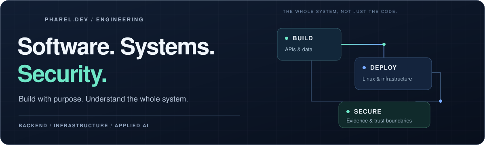

# Lembou Pharel

**Software & Systems Engineer · Backend · DevSecOps · Application Security · Applied AI**

I build backend services, deploy the infrastructure they run on, and investigate the security boundaries between them. My work connects practical software engineering with Linux operations, vulnerability research, and AI-powered tools.

Based in **Yaoundé, Cameroon**. Building independently since **2024**. Open to remote engineering roles and focused technical collaborations.

**[Portfolio](https://pharel.dev)** &nbsp; / &nbsp; [LinkedIn](https://www.linkedin.com/in/lembou-pharel/) &nbsp; / &nbsp; [HackerOne](https://hackerone.com/lembou) &nbsp; / &nbsp; [Writing](https://medium.com/@pharellembou) &nbsp; / &nbsp; **[Get in touch](mailto:lemboupharel@proton.me)**

---

## Engineering across the lifecycle

- **Build:** REST APIs, authentication, relational and geospatial data models, payment integrations, and backend services.
- **Deploy:** Dockerized applications on Linux VPS infrastructure, with Nginx, DNS, TLS, firewall controls, and service troubleshooting.
- **Secure:** Authorized web/API assessment, source review, reproducible findings, and practical remediation guidance.
- **Apply AI:** Agent-based workflows, LLM integrations, model-provider routing, research automation, and computer-vision services.

## Selected public projects

### [Knot](https://github.com/lemboupharel/knot) · Evidence-driven AI research

A research agent and local research workspace built around traceable findings, source-linked evidence, and explicit uncertainty. Designed to make the reasoning behind an answer inspectable, not just produce another answer.

`Python` `AI agents` `LLM integration` `Research workflows`

### [CityLink](https://github.com/lemboupharel/cityLink) · Geospatial systems & applied AI

A waste-management platform combining location-based reporting, mapping, and AI-assisted waste classification. Connects backend APIs and spatial data with a Python vision service and containerized deployment.

`Node.js` `Express` `PostgreSQL` `PostGIS` `Prisma` `FastAPI` `YOLOv8` `Docker`

### [Open Switchn](https://github.com/lemboupharel/open_switchn) · Systems integration research

An **unofficial research CLI and local dashboard** exploring cross-network mobile-money workflows in Cameroon. Focused on API contracts, authentication/session handling, and explicit, one-shot submission safeguards; not a production payment or settlement service.

`TypeScript` `Node.js` `Reverse engineering` `API integration` `Contract testing`

### [Focus / YaoundéTransport](https://github.com/lemboupharel/Focus) · Data analysis for urban mobility

A French-language transport-data application for collecting trips, exploring routes, and visualizing patterns in Yaoundé. Combines a Flask backend with interactive maps, regression, clustering, and dimensionality reduction.

`Python` `Flask` `SQLite` `Machine learning` `Leaflet` `Chart.js`

**More in my portfolio:** [MboaGuard](https://pharel.dev/projects/mboaguard) — AI-assisted security assessment · [OpenSwitchAI](https://pharel.dev/projects/openswitchai) — unified model-provider routing · [PayNow WA](https://pharel.dev/projects/paynow-wa) — WhatsApp-connected payment workflows. These are **prototypes**, with scope and implementation details in their project pages.

## Technical toolkit

| Area | Technologies & practice |
| :--- | :--- |
| **Programming** | JavaScript, TypeScript, Python, Bash, SQL, PHP; additional work with C/C++, Rust, and Solidity |
| **Backend & APIs** | Node.js, Express, Flask, FastAPI, REST, JWT, authentication, authorization, sessions, validation, rate limiting, third-party integrations |
| **Databases & geospatial** | PostgreSQL, PostGIS, Prisma, SQLite, relational schema design, transactions, spatial queries, mapping and synchronization workflows |
| **Infrastructure & delivery** | Linux / Ubuntu, VPS administration, Docker, Docker Compose, Nginx, PM2, Git, GitHub Actions, CI/CD, automation |
| **Networking & operations** | TCP/IP, DNS, Cloudflare, TLS, Certbot, UFW, reverse proxies, monitoring, troubleshooting, server hardening |
| **Application security** | Burp Suite, Nmap, Semgrep, Slither, source review, IDOR / BOLA, JWT and CORS analysis, replay behavior, API access-control testing |
| **Systems research** | Reverse engineering, Linux/browser internals, native keyring integration, cryptographic validation, PBKDF2, AES-GCM / AES-CBC |
| **Applied AI & interfaces** | AI agents, LLM APIs, model routing, evidence-driven research, computer vision, speech-service integration; React, Flutter, HTML/CSS, PWAs |

**Cloud architecture foundations:** AWS IAM, EC2, S3, RDS, CloudFront, WAF, CloudTrail, GuardDuty, and Security Hub; least privilege, secrets management, network segmentation, and defensive monitoring.

**Currently deepening:** Kubernetes, Terraform, infrastructure as code, advanced AWS, and cloud-native / CI/CD security. These are active learning areas, separate from my hands-on delivery toolkit above.

## Security research & technical communication

I work through **HackerOne and HackenProof**, combining source-level investigation with local validation and responsible disclosure.

- **Research recognition:** #1 in Cameroon on HackerOne's **Q3 2026 country leaderboard, web-application category**.
- **Application research:** Reported an accepted, rewarded Medium-severity production telemetry exposure. Further work covers object-level authorization, authentication boundaries, and signed-request behavior, with duplicate reports and conditional risks distinguished from accepted findings.
- **[Browser-storage research](https://github.com/lemboupharel/CrossCrypt):** Python tooling and investigation into browser encryption, Linux keyrings, and cross-platform storage behavior, for authorized local analysis.
- **Public speaking:** Presented **AWS Cloud Security** at Polytechnique Yaoundé in 2026, connecting web/API weaknesses to container, identity, and cloud-resource risks.

**Written authorization, reproducible evidence, and responsible disclosure are part of the work—not an afterthought.** Private reports and client information stay private.

## Learning & foundation

- **Computer Science / Informatics:** Undergraduate studies at the University of Yaoundé I.
- **Coursework:** [IoT Wireless & Cloud Computing Emerging Technologies](https://coursera.org/verify/WANBX9FY9QKS), Yonsei University / Coursera; additional completed courses in Burp Suite, Nmap, reverse engineering, password auditing, and cryptography.
- **Hackathon participation:** NASA International Space Apps Challenge 2025, Open Agent Hackathon 2026, and UNESCO Youth Hackathon 2026.
- **Languages:** French and English.

[View course-completion and participation credentials →](https://pharel.dev/certificates)

---

## Let's build something that holds up

I'm interested in **backend/API engineering**, **Linux and DevOps work**, **authorized security assessments**, and **applied-AI collaborations**—especially where understanding the whole system matters.

**[Discuss a project](https://pharel.dev/contact)** &nbsp; / &nbsp; **[lemboupharel@proton.me](mailto:lemboupharel@proton.me)**

*Build deliberately. Validate assumptions. Leave the system better than you found it.*
